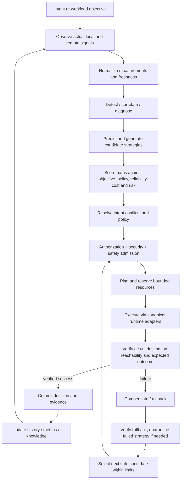
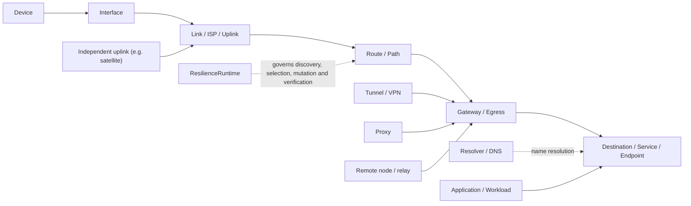
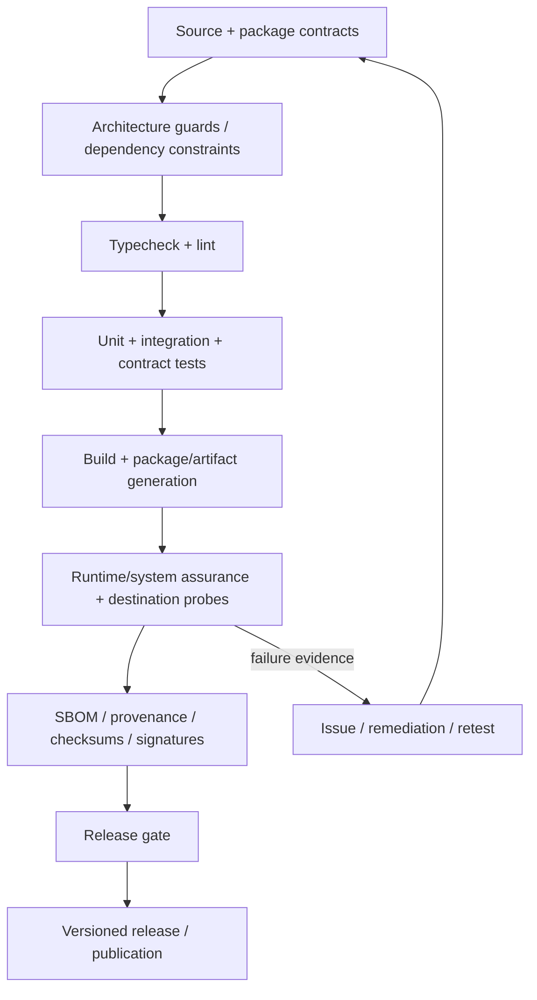

# IRP Superplatform — Full Architecture Map
**Repository:** `nimarahimloo/InternetResiliencePlatform`  
**Branch inspected:** `main`  
**Repository tree SHA inspected:** `e5c6db1b8445d0e200cf066ce8a8e7da2ff46fb7`  
**Purpose:** Evidence-oriented architecture map, package inventory, control/data flows, and explicit implementation boundaries.

> **Status discipline:** This document distinguishes repository structure and documented architecture from verified end-to-end behavior. A package existing in the repository does not prove that its capability is fully integrated, production-ready, or available to every user. The current implementation map in `docs/architecture/system-integration-map.json` explicitly marks several areas as partial.

## 1. Product objective

IRP is intended to become an autonomous network operating system / programmable connectivity fabric that minimizes developer and user network friction. It should observe connectivity, understand intent and constraints, assess candidate paths, make governed decisions, execute bounded changes, verify real destination outcomes, recover safely, and learn from evidence.

It is **not** merely a VPN client, DNS switcher, failover script, dashboard, or package collection.

A key product requirement is zero/low-touch connectivity recovery. However, removing user setup does not make external connectivity resources appear automatically: if a destination is unreachable on the user's direct link, successful recovery requires a genuinely reachable alternate path or infrastructure supplied by IRP or another authorized provider. Starlink, VPN, and proxy are resource classes/adapters—not magic capabilities and not proof of a working path. Each must be discovered/configured/authorized, measured, selected under policy, and verified against the actual destination.

## 2. Architecture at a glance

```mermaid
flowchart TB
  subgraph EXP["L0 — Experience & Workload Plane"]
    USER["User / Operator / Application / Workload"]
    CLI["apps/cli"]
    API["apps/api — management API"]
    DAEMON["apps/daemon — privileged local host"]
    CLIENTS["Linux / macOS / Windows clients"]
    SDK["packages/sdk"]
    USER --> CLI
    USER --> CLIENTS
    USER --> API
    CLI --> SDK
    CLIENTS --> SDK
    API --> DAEMON
  end

  subgraph INTENT["L1 — Intent, Objectives & Constraints"]
    INTENTMODEL["NetworkIntent / objective / scope / priority / TTL / provenance"]
    COMPILER["Normalize → compile → resolve constraints/conflicts"]
    INTENTMODEL --> COMPILER
  end

  subgraph GOV["L2 — Governance & Trust Boundary"]
    POLICY["Policy admission"]
    AUTH["Identity / authentication / authorization"]
    SECURITY["Security / trust / privacy"]
    SAFETY["Safety limits / autonomy level / approvals"]
    POLICY --> SAFETY
    AUTH --> SECURITY
    SECURITY --> SAFETY
  end

  subgraph CTRL["L3 — Canonical Runtime & Control Plane"]
    RUNTIME["@irp/resilience-runtime — ResilienceRuntime"]
    CYCLE["Observe → diagnose → decide → plan"]
    TX["Reserve → execute transaction"]
    VERIFY["Destination/outcome verification"]
    RECOVER["Rollback / recovery / quarantine"]
    LEARN["Commit evidence / learn / update knowledge"]
    RUNTIME --> CYCLE --> TX --> VERIFY
    VERIFY -->|success| LEARN
    VERIFY -->|failure| RECOVER --> CYCLE
  end

  subgraph KNOW["L4 — Knowledge, Intelligence & Optimization"]
    OBS["Observation / measurement"]
    NI["@irp/network-intelligence"]
    IIA["@irp/internet-intelligence-agent"]
    HIST["@irp/historical-analysis"]
    OPT["@irp/auto-optimization"]
    GRAPH["Topology / path graph / failure domains"]
    EVENTS["@irp/events + @irp/queue"]
    METRICS["@irp/metrics + @irp/telemetry"]
    OBS --> NI
    NI --> GRAPH
    IIA --> GRAPH
    HIST --> GRAPH
    OPT --> GRAPH
    EVENTS --> RUNTIME
    METRICS --> RUNTIME
  end

  subgraph FABRIC["L5 — Connectivity Fabric & Network Domain Owners"]
    CONN["@irp/connectivity"]
    NETWORK["@irp/network"]
    ROUTE["@irp/routing"]
    DNS["@irp/dns"]
    GATEWAY["@irp/gateway-registry"]
    TUNNEL["@irp/tunnel"]
    FAILOVER["@irp/failover"]
    RESOURCES["Direct uplink · interface · route · resolver · gateway · tunnel · proxy · egress · remote node"]
    CONN --> RESOURCES
    NETWORK --> RESOURCES
    ROUTE --> RESOURCES
    DNS --> RESOURCES
    GATEWAY --> RESOURCES
    TUNNEL --> RESOURCES
    FAILOVER --> RESOURCES
  end

  subgraph PLATFORM["L6 — Shared Platform, Persistence & Extension System"]
    CORE["@irp/core + @irp/kernel"]
    TYPES["@irp/types + @irp/shared + @irp/utils"]
    CONFIG["@irp/config"]
    DB["@irp/database"]
    AUTHN["@irp/auth"]
    PLUGINS["Plugin API / SDK / loader / manager / registry / runtime / sandbox / config / events / samples"]
    LOG["@irp/logger"]
    CORE --> RUNTIME
    TYPES --> RUNTIME
    CONFIG --> RUNTIME
    DB --> RUNTIME
    AUTHN --> GOV
    PLUGINS --> RUNTIME
    LOG --> RUNTIME
  end

  subgraph OPS["L7 — OS Integration, Delivery & Assurance"]
    LINUX["@irp/linux-client"]
    MAC["@irp/macos-client"]
    WIN["@irp/windows-client"]
    CI["CI / architecture guards / typecheck / lint / tests / build"]
    ASSURE["System assurance / runtime lab / release gate"]
    SUPPLY["Artifacts / checksums / SBOM / provenance / signatures"]
    LINUX --> DAEMON
    MAC --> DAEMON
    WIN --> DAEMON
    CI --> ASSURE --> SUPPLY
  end

  EXP --> INTENT --> GOV --> CTRL
  KNOW --> CTRL
  CTRL --> FABRIC
  PLATFORM --> CTRL
  FABRIC -->|measured real outcome| KNOW
  OPS -. validates and packages .-> EXP
```

### Authority invariant

`@irp/resilience-runtime` is the single canonical production runtime/control authority. Hosts should compose the same canonical runtime and inject platform/domain adapters. Clients, the API, plugins, intelligence components, and domain packages must not become competing privileged orchestrators. Legacy `NetworkAutopilot` is not a production control plane.

## 3. Canonical autonomous control loop

Every attempted mutation needs a traceable chain: **trigger/evidence → decision → policy result → plan → action → destination verification → commit or compensation**. A successful command, a live tunnel, a green health check, or a DNS response alone is not sufficient proof that a target website is reachable.

## 4. Planes and ownership

| Plane | Responsibility | Canonical owner / evidence |
|---|---|---|
| Experience | CLI, API, device clients, operator UX | `apps/api`, `apps/cli`, `packages/*-client`, `packages/sdk`; documented integration map marks clients/API partly connected |
| Intent | Desired outcome, target scope, constraints, priority, TTL, provenance, autonomy level | `@irp/core` schemas + `@irp/resilience-runtime` intent compiler/runtime bridge; conflict resolution and durable ownership remain identified gaps |
| Governance | Authentication, authorization, policy, trust, privacy, safety, approval/autonomy limits | `@irp/auth`, `@irp/security`, runtime policy/safety boundary |
| Runtime/control | Decision lifecycle, orchestration, planning, transaction boundaries, verification, rollback, recovery, learning orchestration | `@irp/resilience-runtime`; sole privileged runtime authority |
| Knowledge | Observations, measurements, topology, history, failure domains, confidence/freshness | `@irp/network-intelligence`, `@irp/historical-analysis`, `@irp/internet-intelligence-agent`, routing path graph, telemetry |
| Connectivity fabric | Interfaces, routes, DNS, gateways, tunnels, egress resources and alternate paths | `@irp/connectivity`, `@irp/network`, `@irp/routing`, `@irp/dns`, `@irp/gateway-registry`, `@irp/tunnel`, `@irp/failover` |
| Platform | Shared types, configuration, persistence, events, queues, logs, metrics, plugin lifecycle | Shared packages and plugin packages; integration status varies |
| OS/device | OS-specific host and network integration | `@irp/linux-client`, `@irp/macos-client`, `@irp/windows-client`; capability parity must be separately evidenced |
| Delivery/assurance | CI, architecture validation, tests, runtime labs, artifacts, release gates and provenance | repository workflows/scripts/docs; passing CI does not by itself certify all user-facing connectivity outcomes |

## 5. Complete workspace inventory observed in `main`

The repository tree contained **3 app manifests and 40 package manifests** (43 total including the root manifest). The roles below are ownership-oriented labels based on package names and existing architecture docs; they are not claims that every capability is production-complete.

### Applications

| Path | Architectural role |
|---|---|
| `apps/api` | HTTP/API boundary, management, authentication/authorization integration |
| `apps/cli` | Command-line experience and operator entry point |
| `apps/daemon` | Local host that composes the canonical runtime and injects local OS/network adapters |

### Runtime, kernel and domain packages

| Package | Architectural responsibility |
|---|---|
| `packages/resilience-runtime` | Canonical runtime authority: decision lifecycle, orchestration, policy/safety admission, transactions, verification, recovery and evidence |
| `packages/kernel` | Foundational kernel-level domain/runtime primitives; must remain subordinate to canonical runtime authority |
| `packages/core` | Core domain model and intent contracts |
| `packages/connectivity` | Connectivity resource abstraction and provider operations |
| `packages/network` | Network domain model and network operations |
| `packages/routing` | Route planning/application and destination-scoped path graph |
| `packages/dns` | DNS strategies, resolver/provider catalog and DNS-domain abstractions |
| `packages/gateway-registry` | Gateway discovery/registry/selection domain |
| `packages/tunnel` | Tunnel resource lifecycle/control abstractions |
| `packages/failover` | Recovery/failover domain providers invoked through canonical runtime |
| `packages/network-intelligence` | Network measurement, signal normalization and intelligence inputs |
| `packages/internet-intelligence-agent` | Advisory external/internet intelligence inputs; not privileged executor |
| `packages/historical-analysis` | Retained measurements/history-based advisory ranking |
| `packages/auto-optimization` | Optimization candidates/objectives; execution remains governed by runtime |

### Platform foundations and services

| Package | Architectural responsibility |
|---|---|
| `packages/types` | Shared type contracts |
| `packages/shared` | Shared primitives and common contracts |
| `packages/utils` | Cross-cutting utility functions |
| `packages/config` | Configuration loading/validation |
| `packages/database` | Durable application persistence boundary; current integration map says canonical runtime cycle still uses in-memory stores |
| `packages/auth` | Authentication/identity integration |
| `packages/security` | Security policy, trust and authorization-related controls |
| `packages/events` | Event contracts and event lifecycle |
| `packages/queue` | Queued/asynchronous work primitives |
| `packages/logger` | Structured logging |
| `packages/metrics` | Metrics and operational counters |
| `packages/telemetry` | Runtime/operational telemetry and diagnostics |

### Plugin ecosystem

| Package | Architectural responsibility |
|---|---|
| `packages/plugin-api` | Extension-facing API contracts |
| `packages/plugin-sdk` | Plugin author SDK |
| `packages/plugin-config` | Plugin configuration contracts/loading |
| `packages/plugin-events` | Plugin event contracts |
| `packages/plugin-loader` | Plugin loading |
| `packages/plugin-manager` | Plugin lifecycle management |
| `packages/plugin-registry` | Plugin discovery/registry |
| `packages/plugin-runtime` | Plugin runtime execution environment |
| `packages/plugin-sandbox` | Plugin isolation/sandbox boundary |
| `packages/plugin-samples` | Example/reference plugins |

### OS clients

| Package | Architectural responsibility |
|---|---|
| `packages/linux-client` | Linux device/runtime integration; current architecture docs identify Linux as the primary local privileged host |
| `packages/macos-client` | macOS client integration |
| `packages/windows-client` | Windows client integration |

### SDK

| Package | Architectural responsibility |
|---|---|
| `packages/sdk` | Public/client integration SDK surface |

## 6. Connectivity resource model

The fabric should model resources as explicit objects with stable identity, capabilities, lifecycle, health, freshness, confidence, ownership, trust, capacity, cost, failure domain, policy restrictions, telemetry and history.

### Resource types to account for

`Device`, `Interface`, `Link`, `Provider`, `Gateway`, `Route`, `Resolver`, `Tunnel`, `Transport`, `Proxy`, `Egress`, `RemoteNode`, `Region`, `Destination`, `Service`, `Endpoint`, `Application`, `Workload`, `Path`.

### Required path selection dimensions

- Destination-specific reachability, not generic internet status alone.
- Latency, loss, throughput, stability and freshness of measurements.
- Independent failure domains and whether two alternatives are genuinely independent.
- Policy, security, user consent, protocol support and OS capability.
- Resource capacity, reliability, cost and operational sustainability.
- Rollback/compensation path and verification method.
- Honest separation of network blocking, origin HTTP errors (including 403), account/authentication errors, regional restrictions, DNS failures, TLS failures and origin outages.

## 7. Alternative connectivity: what IRP must and must not assume

| Resource | Potential role | What must be implemented and verified |
|---|---|---|
| Direct connection | Lowest-overhead default when destination works | Per-destination measurement and health |
| DNS/resolver strategy | Helps when name resolution is the failure or a policy-approved resolver improves reachability | Correct resolution plus destination-level verification; DNS alone cannot bypass every block |
| VPN/tunnel | Encrypted alternate route/egress | Actual reachable endpoint, credentials/authorization, lifecycle management, route integration and destination verification |
| HTTP(S)/SOCKS proxy | Alternate route for supported traffic | Protocol coverage, auth, app/system routing, privacy/security, availability and real request verification |
| Gateway/remote egress | Shared platform-provided path or relay, if built and operated | Real infrastructure, capacity, abuse controls, reliability, privacy, funding, jurisdiction and endpoint availability |
| Starlink/other independent uplink | Independent access network or uplink where physically/service-available | Real terminal/service/link and integration with OS route discovery and path selection |
| Other provider/plugin | Extensible path or diagnostic provider | Capability declaration, trust, policy admission, sandboxing, lifecycle and verification |

**Critical product truth:** “No user-purchased VPN” is a valid product objective, but it does not remove the need for a working alternate path. To serve users with no personal VPN/proxy and a filtered direct connection, IRP would need to supply or coordinate access to its own reachable infrastructure or other authorized resources. The repo’s adapter abstractions alone do not establish that infrastructure exists.

## 8. Current integration state recorded by the repository's map

The checked-in `docs/architecture/system-integration-map.json` describes a Phase 78 reconstruction baseline and is not a current release certification. Its recorded states include:

- **Connected in the documented local path:** daemon → canonical runtime; runtime decision inputs; connectivity/routing adapters; gateway/tunnel control contracts; failover provider; telemetry; destination-scoped routing path graph; historical advisory input.
- **Partially connected / explicitly open:** clients, API, intent lifecycle, DNS hosting/activation, federation, authentication/security integration, database durability, plugin lifecycle.
- **Specific gaps recorded in the reconstruction report:** conflict resolution and durable intent ownership; live policy-governed activation; canonical runtime stores still in-memory; plugin lifecycle separate from mutation authority; incomplete end-to-end path graph spanning destination/provider/remote node/region/history/federation; live tunnel defaults off at daemon boundary; external connectivity resource provisioning and all-destination reachability are not proven by the map.

These states must be revalidated against the current source and runtime evidence before being presented as current status.

## 9. Engineering, assurance and release plane

Release rules:
1. A package compile is not end-to-end completion.
2. A green unit test is not proof of production reachability.
3. A successful tunnel handshake is not proof a target website works.
4. A skipped or stale runtime-lab result must not be represented as successful certification.
5. Security/provenance gaps and dependency advisories must be explicit release blockers where policy requires.
6. Issue closure requires code/test/runtime evidence at the relevant boundary.

## 10. Non-negotiable architecture invariants

1. Exactly one production `ResilienceRuntime` authority.
2. Production hosts compose through the canonical runtime factory; host-specific code injects adapters rather than recreating orchestration.
3. `NetworkAutopilot` must not regain production authority.
4. No second decision engine, policy engine, safety kernel, global state registry, provider registry, event bus, planner or transaction executor.
5. Intelligence/AI can advise and rank candidates but cannot bypass policy, security, safety or transaction execution.
6. Every privileged network mutation is authorized, bounded, traceable and verified against a real outcome.
7. Verification failure leads to compensation/recovery and evidence, not false success.
8. Package presence must not be confused with package integration or user-visible capability.
9. Planned capabilities must be labelled planned; implemented, partial, blocked and unverified states must remain distinct.
10. Alternate connectivity requires a real, reachable resource and must account for privacy, consent, abuse prevention, capacity and operational cost.

## 11. Canonical repository references

- `docs/architecture/IRP-SUPERPLATFORM-REFERENCE-ARCHITECTURE.md` — architecture north star and canonical control model.
- `docs/architecture/IRP-ARCHITECTURE-CONTRACT.json` — machine-readable authority invariants.
- `docs/architecture/system-architecture.md` — current subsystem overview.
- `docs/architecture/system-integration-map.json` — package/system integration graph and evidence paths.
- `docs/architecture/runtime-execution-graph.json` — runtime execution graph.
- `docs/architecture/failure-recovery-graph.json` — failure and recovery graph.
- `docs/architecture/security-boundary-graph.json` — security boundaries.
- `docs/audits/full-system-architecture-reconstruction.md` — evidence-based reconstruction and gaps.
- `docs/roadmap/MASTER_ROADMAP_V2.md` — post-Phase-70 roadmap; phase completion still requires current evidence.

## 12. Scope and limitations of this artifact

This is a consolidated architecture map based on the checked-in reference architecture, system architecture, integration map and the repository tree. It is intentionally not a claim that every future layer is implemented. It also does not replace a source-derived package dependency graph: package-to-package import edges, exported symbols, runtime entrypoints and platform-specific mutation paths should be extracted automatically and checked against this conceptual map as a separate validation artifact.

**Acceptance criterion for a truly exhaustive map:** every app/package, important source entrypoint, public contract, runtime adapter, persistent store, plugin boundary, workflow, and release artifact must appear as a node or documented subgraph; every edge must identify a concrete import/call/contract/workflow dependency or be explicitly labelled conceptual; each node must have an implementation state and evidence pointer.